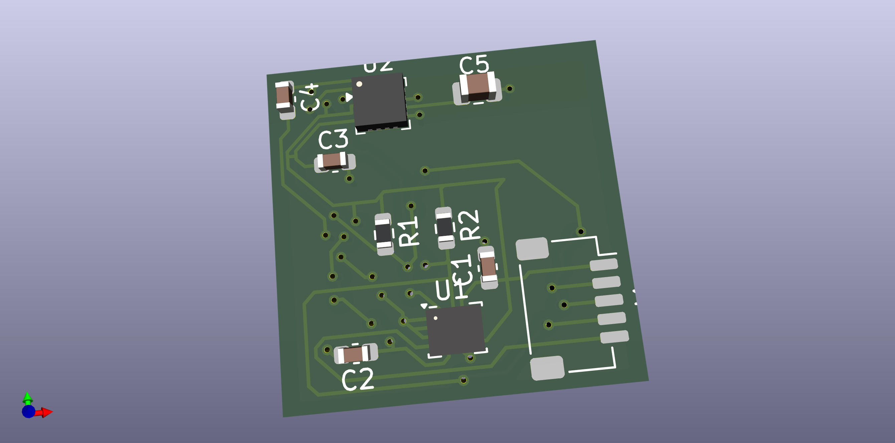
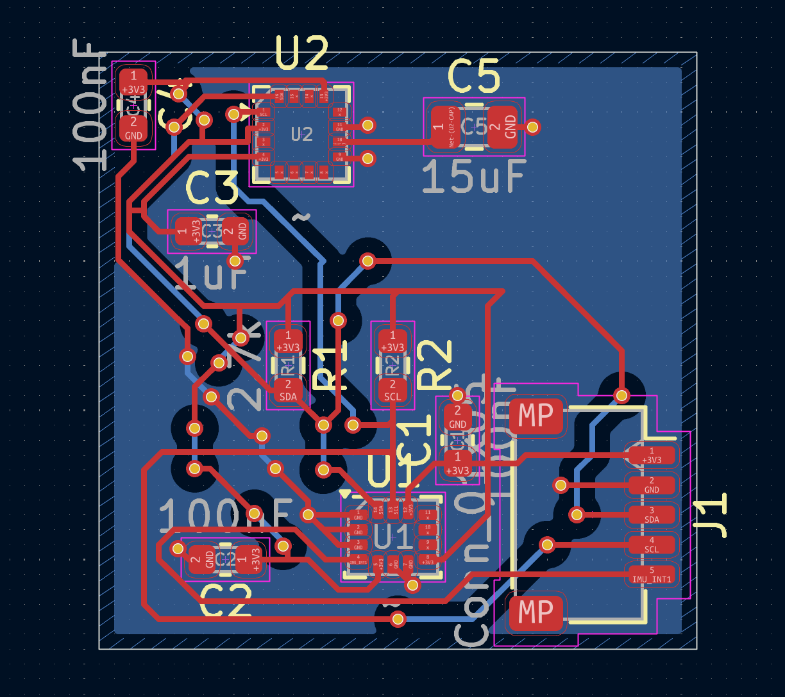
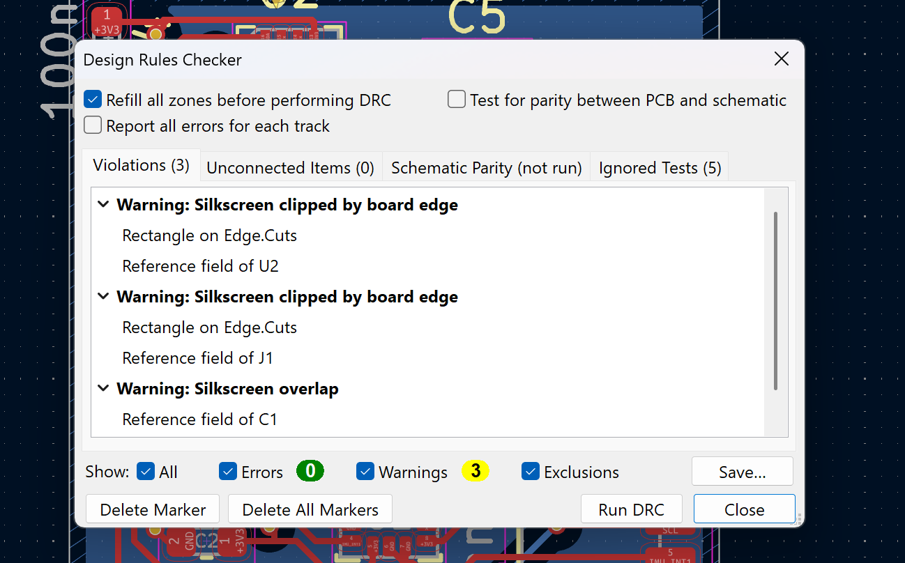

9-DOF IMU with Magnetometer — Custom KiCad PCB
Custom two-layer sensor PCB integrating a 6-axis inertial sensor and a 3-axis magnetometer over I²C.

> **Project status:** Schematic and PCB layout completed in KiCad 9. The latest documented PCB design-rules check reported **0 errors**, **0 unconnected items**, and **3 silkscreen warnings**. The board has **not been fabricated, assembled, powered, or bench-tested**. This repository documents a PCB design—not a demonstrated working physical device.
Quick overview
The board combines measurements from two sensor ICs:
Device	Function	Role in the design
ST LSM6DSO32X	3-axis accelerometer + 3-axis gyroscope	Six inertial sensing axes, including a selectable accelerometer full-scale range up to ±32 g
MEMSIC MMC5983MA	3-axis magnetometer	Three magnetic-field sensing axes
Together they provide nine sensing axes (3 acceleration + 3 angular velocity + 3 magnetic field). This is a 9-axis sensor board, not a board that already performs sensor fusion, attitude estimation, or navigation on its own. A separate host controller and firmware would be needed to acquire and process measurements.
Design environment: KiCad 9 · schematic capture · custom sensor symbols · two-layer PCB layout · copper zones · routing · design-rule checking.
Gallery
PCB 3D view

KiCad 3D render of the current design. The connector body does not appear in this rendering because its 3D model has not been attached; its footprint is present in the PCB design.
PCB routing and layer view

PCB Editor capture showing the routed board and copper regions. Visible silkscreen labels overlap in places, consistent with the three documented DRC warnings.
Electrical schematic
View the schematic PDF, or open the KiCad schematic source.
Design verification evidence

Architecture
```text
             External 3.3 V supply + host controller
                               |
              5-pin interface J1: 3V3, GND,
                        SDA, SCL, INT1
                               |
                +--------------+--------------+
                |                             |
          I²C SDA / SCL                Interrupt to host
                |                             ^
        +-------+---------+                   |
        |                 |                   |
  +-----v------+   +------v------+      from LSM6DSO32X
  | LSM6DSO32X |   | MMC5983MA   |
  | accel +    |   | magnetometer|
  | gyro (6)   |   | (3)         |
  +------------+   +-------------+
```
Both sensors are intended to share the I²C bus; the board contains pull-up resistors for the bus lines. The connector exposes the supply, ground, serial lines, and one inertial-sensor interrupt signal. The board does not contain an onboard microcontroller or firmware.
External interface (J1)
Pin	Label shown in the design	Function
1	`+3V3`	External regulated 3.3 V input
2	`GND`	Ground
3	`SDA`	I²C data
4	`SCL`	I²C clock
5	`IMU_INT1`	LSM6DSO32X interrupt routed to host
> Check pin numbering and orientation in the source PCB/footprint before connecting any hardware. A 3D connector body is not currently rendered.
Circuit design
Sensor selection
LSM6DSO32X: integrates a digital 3-axis accelerometer and 3-axis gyroscope. The device supports several programmable accelerometer ranges, with ±32 g as the maximum listed range. The board does not by itself configure the sensor to any one range; that would be done by host firmware.
MMC5983MA: adds three-axis magnetic-field sensing through a separate digital sensor IC.
Refer to the manufacturer datasheets for actual operating ranges, initialization procedures, I²C addresses, and recommended application circuits: references.
Power and decoupling
The design exposes the +3V3 rail through J1. It is intended to be supplied by an external, regulated 3.3 V source; no on-board 3.3 V regulator is shown in the documented schematic. Local capacitors are placed at sensor supply pins. The magnetometer's `CAP` connection includes a bulk capacitor (shown as 15 µF in the source design), supporting its internal SET/RESET circuitry; MEMSIC recommends a nearby low-ESR capacitor of at least 10 µF on this pin.
I²C and interrupts
The design includes SDA/SCL pull-ups to the 3.3 V rail and exports both lines on J1. The inertial sensor's `INT1` is routed out to the interface. An additional `INT2` signal is not exported on the documented 5-pin interface.
PCB layout
The board is laid out with two copper layers. Front and back copper are visible in the screenshots; the back layer contains a ground-filled region. Component placement, short local sensor support connections, via transitions, and the ground network were considered during routing.
Engineering debugging example
During PCB review, an apparently blue (ground) region did not necessarily mean every nearby GND pad was electrically connected. A region of ground copper was isolated by routing/clearance geometry. The final design was corrected by explicitly connecting the affected ground network around the decoupling capacitor, then refilling zones and rerunning DRC. This highlighted the difference between a visually present copper pour and an electrically connected ground net.
Verification and limitations
Check	Observed outcome	Interpretation
PCB DRC errors	0	No errors reported by the enabled DRC checks
Unconnected items	0	No unconnected items reported
DRC warnings	3	Two silkscreen references clipped by board edge (U2, J1); one overlap (C1)
Schematic-to-PCB parity	Not run in screenshot	This specific parity test is not claimed as passed
Ignored tests	5 listed	Not all possible tests were enabled
Fabrication / assembly	Not performed	Physical manufacturing not established
Power-up / signal tests	Not performed	Electrical or sensor performance not verified
Scope: This repository demonstrates schematic design, component integration, custom symbol handling, PCB layout, routing, and DRC-based verification. It does not claim tested noise performance, calibrated sensor outputs, sensor fusion, functional firmware, or hardware validation.
Repository structure
```text
9-DOF-IMU-PCB/
├── README.md
├── Hardware/
│   ├── 9 Axis IMU with a Magnetometer.kicad_pro
│   ├── 9 Axis IMU with a Magnetometer.kicad_sch
│   ├── 9 Axis IMU with a Magnetometer.kicad_pcb
│   ├── LSM6DSO32X.kicad_sym
│   ├── MMC5983MA.kicad_sym
│   └── sym-lib-table
├── Images/
│   ├── pcb-3d-front.png
│   ├── pcb-layout.png
│   └── drc-results.png
└── Docs/
    ├── schematic.pdf
    ├── design-notes.md
    └── references.md
```
Opening the design in KiCad
Install KiCad 9.
Clone or download this repository.
Open `Hardware/9 Axis IMU with a Magnetometer.kicad_pro` in KiCad.
Open the schematic and PCB from the KiCad project manager.
Confirm the project-local custom symbol libraries resolve and review the schematic against the PDF.
Run DRC yourself in PCB Editor using the project settings. For results directly comparable to the screenshot, review which checks are enabled, including parity.
Portability note: The design uses custom `.kicad_sym` libraries. `Hardware/sym-lib-table` should reference these with project-relative `${KIPRJMOD}` paths, not paths to the original creator's Windows account. Verify library paths before distributing the project; successful opening on the original computer alone does not prove portability to another computer.
Design decisions and background
See Design Notes for sensor interfaces, support circuitry, board layout, verification, engineering lessons, and next steps.
Further development (not yet completed)
Resolve or formally accept silkscreen warnings, particularly if fabricating the board.
Attach and check an appropriate 3D connector model and verify the actual connector footprint/pin orientation.
Validate project library portability on another computer.
Run schematic ERC and schematic-to-PCB parity checks, and investigate any issues found.
Manufacture and assemble a prototype.
Develop firmware to scan the I²C bus, initialize both sensors, and capture measurements.
Test power integrity, interrupts, I²C operation, orientation behavior, and calibration.
References
LSM6DSO32X — STMicroelectronics datasheet
MMC5983MA — MEMSIC datasheet
KiCad 9 documentation
---
Author: Bilal-Ship  
Project type: Personal hardware/PCB design portfolio project  
Status: Design completed; unmanufactured and untested
